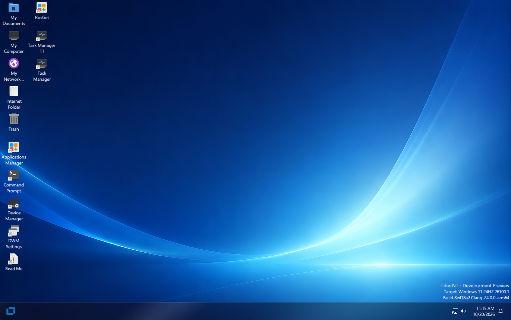

<p align="center">
  
</p>

> [!IMPORTANT]
> LiberNT is in active development. The builds on the [Releases](https://github.com/LiberNT/LiberNT/releases) page are Debug pre-releases for testing: run them in a virtual machine or on spare hardware, not on a computer you depend on.

<div align="center">

# [LiberNT](https://libernt.com)
### A free NT operating system

**Built out of love for the NT architecture. Windows® 11 compatible, for amd64, arm64 and riscv64.**

[](https://github.com/LiberNT/LiberNT/actions/workflows/build.yml)
[](#license)
[](https://discord.gg/BpcKg7FZ2)
[](https://matrix.to/#/#libernt:matrix.org)


<br>

[](https://github.com/LiberNT/LiberNT/releases)

</div>

## Sponsors

<p align="center">
  <a href="https://github.com/sponsors/ahmedarif193">
    
  </a>
</p>

---

<p align="center">
  
</p>

<p align="center"><sub>The LiberNT desktop on arm64, from build nt10.0-043-2555 in QEMU</sub></p>

---

LiberNT is a free NT operating system. The name says it: *liber* is Latin for **free**. It targets **Windows® 11 compatibility**, with room for freestyle and experimental features.

LiberNT brings extensive work on kernel-space components and drivers, aimed at stability and modern hardware, and it focuses on 64-bit platforms: **amd64, arm64 and riscv64**.

Our goal is a system that stays maintainable in the long run: **stable, reliable and efficient**, running on embedded devices too, and able to support every feature a modern operating system should have.

> [!NOTE]
> New to NT? **NT** is the architecture behind every modern version of Windows: its kernel, driver model and system services. LiberNT is a free operating system built on that architecture, and Windows 11 is the reference it measures itself against.

---

## Table of Contents

- [What LiberNT Includes](#what-libernt-includes)
- [Supported Platforms](#supported-platforms)
- [Getting Started](#getting-started)
  - [Step 1: Download a Build](#step-1-download-a-build)
  - [Step 2: Boot It](#step-2-boot-it)
  - [Step 3: Install LiberNT](#step-3-install-libernt)
- [Building LiberNT Yourself](#building-libernt-yourself)
- [Build Hosts](#build-hosts)
- [Project Structure](#project-structure)
- [Contributing](#contributing)
- [Use of AI](#use-of-ai)
- [License](#license)
- [About](#about)

---

## What LiberNT Includes

LiberNT brings modern hardware and platforms to the NT architecture.

| Feature | What it means for you |
| --- | --- |
| **64-bit first** | The kernel, HAL and FreeLoader run on amd64, arm64 and riscv64. |
| **UEFI boot** | Boots on UEFI firmware, with a GOP framebuffer and early display support. The preinstalled disk boots with UEFI or BIOS. |
| **Modern buses and storage** | PCIe, PCI, Plug and Play, USB with xHCI, SD/eMMC, and storage and bus drivers. |
| **Board support** | Real boards, including the Raspberry Pi and its RP1 I/O controller. |
| **The Windows 11 driver model** | Windows 11 (NT10) compatibility and driver-model work, checked against Windows 11 itself. |
| **Graphics and x86 apps on Arm** | The graphics driver model with Mesa, and WoW64 with FEX, are build options you can switch on. |
| **LiberNT Setup** | Lists drives the way Windows Setup does, creates, deletes, formats, shrinks and extends partitions, and installs LiberNT on NTFS with the EFI system partition it needs. |
| **Your own build** | `menuconfig` lets you choose the target, compiler and build type, and switch features on or off. |

> [!TIP]
> Each build on the [Releases](https://github.com/LiberNT/LiberNT/releases) page lists what changed since the previous one.

---

## Supported Platforms

| Architecture | Prebuilt images | Build from source | Notes |
| --- | :---: | :---: | --- |
| **amd64** | ✓ | ✓ | Clang (default) or GCC |
| **arm64** | ✓ | ✓ | Includes Raspberry Pi support |
| **riscv64** | ✓ | ✓ | A separate image is built for JH7110 boards |
| **i386** | | ✓ | 32-bit x86 |

Release builds also include PowerPC images.

---

## Getting Started

### Step 1: Download a Build

Every build on the [Releases](https://github.com/LiberNT/LiberNT/releases) page comes as one ZIP file per image and architecture:

| File | What it is |
| --- | --- |
| `bootcd-iso-…-<arch>-…zip` | `bootcd.iso`, a CD image that runs LiberNT or starts LiberNT Setup |
| `LiberNT-img-…-<arch>-…zip` | `LiberNT.img`, a disk with LiberNT already installed |
| `LiberNT-vhd-…-<arch>-…zip` | `LiberNT.vhd`, the same preinstalled disk for VHD-based virtual machines |
| `LiberNT-vhdx-…-<arch>-…zip` | `LiberNT.vhdx`, the same preinstalled disk for Hyper-V Generation 2 |

> [!NOTE]
> These are Clang Debug builds, made by GitHub Actions from the `main-nt10` branch.

### Step 2: Boot It

The quickest way to try LiberNT is the preinstalled disk:

1. Unzip `LiberNT.img` (or `LiberNT.vhd`)
2. Start it in a virtual machine such as **QEMU**, or use the VHD in **VirtualBox** or a **Hyper-V** Generation 1 virtual machine. Hyper-V Generation 2 takes only `LiberNT.vhdx`, with Secure Boot turned off
3. Or write `LiberNT.img` to a USB drive or an SD card and boot the machine from it. It boots with UEFI or BIOS

> [!CAUTION]
> Writing `LiberNT.img` to a USB drive or an SD card erases everything on it. Double-check the target device first.

### Step 3: Install LiberNT

Boot `bootcd.iso` in a virtual machine or on a PC, and follow the instructions of **LiberNT Setup**.

The preinstalled disk also carries LiberNT Setup. Run `C:\<architecture>\libernt.exe`, for example `C:\arm64\libernt.exe`, to install LiberNT on another disk from the running system.

> [!CAUTION]
> Setup can delete and format partitions. Back up anything important on the target disk before you install.

See [INSTALL.md](INSTALL.md) for the full installation guide.

---

## Building LiberNT Yourself

LiberNT builds with RosBE, a cross-build toolchain. The steps below work on Linux and macOS, and on Windows through WSL2.

### 1. Install the toolchain

You need Git, CMake, Ninja and a C/C++ compiler for your own machine. RosBE adds the compilers that build LiberNT.

```sh
curl -fsSL https://raw.githubusercontent.com/LiberNT/libernt-build-toolchain/main/rosbe-unix-bootstrap.sh | sh
```

> [!TIP]
> On Windows, we suggest WSL2. Install it with `wsl --install`, open the Linux terminal it adds, and follow the Linux steps there. Keep the source inside the Linux file system rather than under `/mnt/c`, where builds run slower.

### 2. Get the source

```sh
git clone https://github.com/LiberNT/LiberNT.git
cd LiberNT
```

> [!NOTE]
> The first configure run also fetches the submodule and external sources the build needs.

### 3. Configure

```sh
./configure.sh
```

With no options, this sets up an AMD64 Debug build with Clang in the folder `output-Clang-amd64-debug`. The folder name always follows the pattern `output-<compiler>-<architecture>-<debug|release>`.

| Option | What it does |
| --- | --- |
| `-a`, `--arch <arch>` | Chooses the target architecture: `amd64` (default), `i386`, `arm64` or `riscv64`. |
| `--clang` | Builds with Clang/LLVM from RosBE. This is the default. |
| `--gcc` | Builds with GCC from RosBE instead of Clang. The macOS RosBE does not include GCC. |
| `-r`, `--release` | Makes an optimized Release build. Without it you get a Debug build, which is easier to debug. |
| `menuconfig` | Opens a menu to choose optional components first. Your choices are kept in the output folder. |
| `makefiles` | Uses `make` instead of Ninja. |
| `--no-feeds-update` | Skips fetching the external sources listed in `feeds.conf`, for example when offline. |
| `-D<name>=<value>` | Passes a setting straight to CMake. |

For example:

```sh
./configure.sh -a arm64              # ARM64 Debug build with Clang
./configure.sh -a i386 --gcc         # 32-bit x86 build with GCC
./configure.sh -a amd64 --release    # optimized AMD64 build
```

For a more personalized build, add `menuconfig`:

```sh
./configure.sh menuconfig
```

It opens a menu, much like the Linux kernel's, where you choose the target, compiler and build type, and switch features on or off: code generation and tuning, graphics driver model and Mesa, WoW64 and FEX, kernel debugging, test runs and more. Press `?` on any option for help, `S` to save and `Q` to quit. Your choices are saved in the output folder and used every time you configure it again.

### 4. Build

Go to the output folder and run Ninja with the target you want:

```sh
cd output-Clang-amd64-debug
ninja liberntimg
```

| Command | Creates | Use it to |
| --- | --- | --- |
| `ninja bootcd` | `bootcd.iso` | Install LiberNT from a CD image, in a virtual machine or on a PC. |
| `ninja liberntimg` | `LiberNT.img` | Boot a disk with LiberNT already installed. Start it in a virtual machine such as QEMU, or write it to a USB drive or SD card. It boots with UEFI or BIOS. |
| `ninja liberntvhd` | `LiberNT.vhd`, `LiberNT.vhdx` | Use the same preinstalled disk in virtual machines: the VHD in VirtualBox and Hyper-V Generation 1, the VHDX in Hyper-V Generation 2, which does not take VHD disks. |

Each target builds everything it needs first, and the files are written to the output folder.

---

## Build Hosts

| Host | Compilers | Notes |
| --- | --- | --- |
| **Linux** x86_64 / aarch64 | Clang and GCC | The full RosBE toolchain |
| **macOS** Intel / Apple Silicon | Clang | RosBE has no GCC build for macOS |
| **Windows** | Clang and GCC | Through WSL2, following the Linux steps |

On every host, install Git, CMake, Ninja, Flex and Bison from your package manager. RosBE provides only the cross compilers. Prebuilt toolchains live in [LiberNT/libernt-build-toolchain](https://github.com/LiberNT/libernt-build-toolchain).

---

## Project Structure

```text
LiberNT/
├── base/            # Applications, services, setup and the shell
├── boot/            # FreeLoader, boot data and boot images
├── bootloader/      # Boot manager, Windows loader, UEFI and Open Firmware support
├── dll/             # User-mode DLLs, including ntdll and the Win32 libraries
├── drivers/         # Kernel-mode drivers: buses, storage, file systems, network, input and more
├── hal/             # Hardware abstraction layers for x86, Arm, Arm64, PowerPC and RISC-V
├── media/           # Fonts, themes, INF files, sounds and branding
├── modules/         # Optional applications, tests and wallpapers
├── ntoskrnl/        # The NT kernel and executive
├── sdk/             # Headers, libraries and build tools
├── submodules/      # Recipes and patches for external components
├── subsystems/      # CSRSS and the Windows subsystem
├── win32ss/         # win32k, USER, GDI and display drivers
├── configure.sh     # Sets up a build on Linux, macOS and WSL2
└── configure.cmd    # Sets up a build on Windows
```

---

## Contributing

Report bugs and suggest features in [Issues](https://github.com/LiberNT/LiberNT/issues), and find guides and notes in the [Wiki](https://github.com/LiberNT/LiberNT/wiki).

See [CONTRIBUTING.md](CONTRIBUTING.md) and [PULL_REQUEST_MANAGEMENT.md](PULL_REQUEST_MANAGEMENT.md). If you're planning a larger change, ask in [Issues](https://github.com/LiberNT/LiberNT/issues) or on [Discord](https://discord.gg/BpcKg7FZ2) first.

> [!WARNING]
> **Legal notice:** If you have seen proprietary Microsoft Windows source code (including but not limited to the leaked Windows NT 3.5, NT 4, 2000 source code and the Windows Research Kernel), your contribution won't be accepted because of potential copyright violation.

---

## Use of AI

We want to make it clear: AI is part of how LiberNT is built. It helps us review and write code, and everything it writes is then reviewed by a human. Before anything reaches the main branch, a person runs and validates the end-to-end tests. We care about this project too much to let a regression slip through.

It also helps us read documentation, extract definitions and fix bugs. For any given bug, it compares what the official Microsoft Learn documentation says with what our function actually does, so we can see exactly where our behavior differs.

Like any other tool, AI is there to help us achieve our goals. It follows the same rules we hold ourselves to, set out in [AGENTS.md](AGENTS.md):

- We build from the Windows SDK and WDK headers, Windows 11 public symbols, Microsoft documentation and black-box runs on Windows 11.
- We stay clean-room: we never transcribe disassembled or decompiled Windows code, and we never copy GPL code from Linux.
- A fix is only a fix once we have seen it work in a real boot or test run. Once tests pass, a future CI will keep them passing and preserve our overall progress.
- We compare our test results check by check with the same tests run on Windows 11.

> [!TIP]
> If you use AI in your own contributions, you are welcome here too. Just tell us in the pull request which parts it helped with and how you tested them. That honesty is all we ask.

---

## License

LiberNT is licensed under the [GNU GPL 3.0](COPYING). Code inherited from other projects keeps the licence stated in its file headers, most of it GPL 2.0 or later. The GPL 2.0, LGPL 2.1 and BSD texts those files refer to are in [COPYING2](COPYING2), [COPYING.LIB](COPYING.LIB) and [COPYING.ARM](COPYING.ARM).

The changes made in LiberNT are Copyright © 2026 the LiberNT contributors. Inherited and third-party code keeps the copyright notices of its authors. See [CREDITS.md](CREDITS.md).

LiberNT is an independent project. It is not affiliated with, endorsed by or sponsored by Microsoft. Windows® is a registered trademark of Microsoft Corporation.

---

## About

LiberNT is built by the **LiberNT contributors**, started and maintained by [Ahmed Arif](https://github.com/ahmedarif193).

- [Visit the LiberNT organization](https://github.com/LiberNT)
- [Website](https://libernt.com)
- [Download the latest build](https://github.com/LiberNT/LiberNT/releases)
- [Wiki](https://github.com/LiberNT/LiberNT/wiki)
- Chat on [Discord](https://discord.gg/BpcKg7FZ2) or [Matrix](https://matrix.to/#/#libernt:matrix.org)
