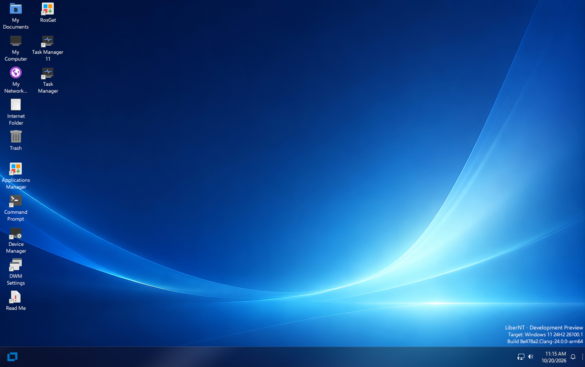

> [English](../../README.md) | [中文](../zh-CN/README.md) | [Français](../fr-FR/README.md) | **Español** | [日本語](../ja-JP/README.md) | [العربية](../ar-MA/README.md) | [Українська](../uk-UA/README.md)

<p align="center">
  
</p>

> [!IMPORTANT]
> LiberNT está en pleno desarrollo. Las compilaciones de la página [Releases](https://github.com/LiberNT/LiberNT/releases) son versiones preliminares Debug para pruebas: ejecútalas en una máquina virtual o en un equipo de repuesto, no en un ordenador del que dependas.

<div align="center">

# [LiberNT](https://libernt.com)
### Un sistema operativo NT libre

**Creado por amor a la arquitectura NT. Compatible con Windows® 11, para amd64, arm64 y riscv64.**

[](https://github.com/LiberNT/LiberNT/actions/workflows/build.yml)
[](#licencia)
[](https://discord.gg/BpcKg7FZ2)
[](https://matrix.to/#/#libernt:matrix.org)


<br>

[](https://github.com/LiberNT/LiberNT/releases)

</div>

## Patrocinadores

<p align="center">
  <a href="https://github.com/sponsors/ahmedarif193">
    
  </a>
</p>

---

<p align="center">
  
</p>

<p align="center"><sub>El escritorio de LiberNT en arm64, de la compilación nt10.0-043-2555 en QEMU</sub></p>

---

LiberNT es un sistema operativo NT libre. El nombre lo dice: *liber* significa **libre** en latín. Su objetivo es la **compatibilidad con Windows® 11**, con espacio para funciones libres y experimentales.

LiberNT aporta un trabajo extenso sobre los componentes del espacio del kernel y los controladores, orientado a la estabilidad y al hardware moderno, y se centra en las plataformas de 64 bits: **amd64, arm64 y riscv64**.

Nuestro objetivo es un sistema que se pueda mantener a largo plazo: **estable, fiable y eficiente**, que funcione también en dispositivos embebidos y que pueda ofrecer todas las funciones que debe tener un sistema operativo moderno.

> [!NOTE]
> ¿Nuevo en NT? **NT** es la arquitectura que hay detrás de todas las versiones modernas de Windows: su kernel, su modelo de controladores y sus servicios del sistema. LiberNT es un sistema operativo libre construido sobre esa arquitectura, y Windows 11 es la referencia con la que se compara.

---

## Índice

- [Qué incluye LiberNT](#qué-incluye-libernt)
- [Plataformas compatibles](#plataformas-compatibles)
- [Primeros pasos](#primeros-pasos)
  - [Paso 1: descargar una compilación](#paso-1-descargar-una-compilación)
  - [Paso 2: arrancarla](#paso-2-arrancarla)
  - [Paso 3: instalar LiberNT](#paso-3-instalar-libernt)
- [Compilar LiberNT por tu cuenta](#compilar-libernt-por-tu-cuenta)
- [Sistemas de compilación](#sistemas-de-compilación)
- [Estructura del proyecto](#estructura-del-proyecto)
- [Contribuir](#contribuir)
- [Uso de la IA](#uso-de-la-ia)
- [Licencia](#licencia)
- [Acerca de](#acerca-de)

---

## Qué incluye LiberNT

LiberNT lleva el hardware y las plataformas modernas a la arquitectura NT.

| Función | Lo que significa para ti |
| --- | --- |
| **64 bits primero** | El kernel, la HAL y FreeLoader funcionan en amd64, arm64 y riscv64. |
| **Arranque UEFI** | Arranca en firmware UEFI, con framebuffer GOP y soporte de pantalla temprano. El disco preinstalado arranca con UEFI o BIOS. |
| **Buses y almacenamiento modernos** | PCIe, PCI, Plug and Play, USB con xHCI, SD/eMMC, y controladores de almacenamiento y de bus. |
| **Soporte de placas** | Placas reales, incluida la Raspberry Pi y su controlador de E/S RP1. |
| **El modelo de controladores de Windows 11** | Compatibilidad con Windows 11 (NT10) y trabajo sobre el modelo de controladores, comprobado con el propio Windows 11. |
| **Gráficos y aplicaciones x86 en Arm** | El modelo de controladores gráficos con Mesa, y WoW64 con FEX, son opciones de compilación que puedes activar. |
| **Instalación de LiberNT** | Muestra las unidades igual que el instalador de Windows, crea, elimina, formatea, reduce y amplía particiones, e instala LiberNT en NTFS con la partición del sistema EFI que necesita. |
| **Tu propia compilación** | `menuconfig` te permite elegir el destino, el compilador y el tipo de compilación, y activar o desactivar funciones. |

> [!TIP]
> Cada compilación de la página [Releases](https://github.com/LiberNT/LiberNT/releases) indica qué ha cambiado desde la anterior.

---

## Plataformas compatibles

| Arquitectura | Imágenes precompiladas | Compilar desde el código fuente | Notas |
| --- | :---: | :---: | --- |
| **amd64** | ✓ | ✓ | Clang (predeterminado) o GCC |
| **arm64** | ✓ | ✓ | Incluye soporte para Raspberry Pi |
| **riscv64** | ✓ | ✓ | Se compila una imagen aparte para placas JH7110 |
| **i386** | | ✓ | x86 de 32 bits |

Las compilaciones publicadas también incluyen imágenes para PowerPC.

---

## Primeros pasos

### Paso 1: descargar una compilación

Cada compilación de la página [Releases](https://github.com/LiberNT/LiberNT/releases) se ofrece como un archivo ZIP por imagen y arquitectura:

| Archivo | Qué es |
| --- | --- |
| `bootcd-iso-…-<arch>-…zip` | `bootcd.iso`, una imagen de CD que ejecuta LiberNT o inicia la instalación de LiberNT |
| `LiberNT-img-…-<arch>-…zip` | `LiberNT.img`, un disco con LiberNT ya instalado |
| `LiberNT-vhd-…-<arch>-…zip` | `LiberNT.vhd`, el mismo disco preinstalado para máquinas virtuales basadas en VHD |
| `LiberNT-vhdx-…-<arch>-…zip` | `LiberNT.vhdx`, el mismo disco preinstalado para Hyper-V de generación 2 |

> [!NOTE]
> Son compilaciones Debug con Clang, generadas por GitHub Actions a partir de la rama `main-nt10`.

### Paso 2: arrancarla

La forma más rápida de probar LiberNT es el disco preinstalado:

1. Descomprime `LiberNT.img` (o `LiberNT.vhd`)
2. Inícialo en una máquina virtual como **QEMU**, o usa el VHD en **VirtualBox** o en una máquina virtual **Hyper-V** de generación 1. Hyper-V de generación 2 solo acepta `LiberNT.vhdx`, con el arranque seguro desactivado
3. O escribe `LiberNT.img` en una unidad USB o una tarjeta SD y arranca el equipo desde ella. Arranca con UEFI o BIOS

> [!CAUTION]
> Escribir `LiberNT.img` en una unidad USB o una tarjeta SD borra todo su contenido. Comprueba bien el dispositivo de destino antes.

### Paso 3: instalar LiberNT

Arranca `bootcd.iso` en una máquina virtual o en un PC y sigue las instrucciones de la **instalación de LiberNT**.

El disco preinstalado también incluye la instalación de LiberNT. Ejecuta `C:\<arquitectura>\libernt.exe`, por ejemplo `C:\arm64\libernt.exe`, para instalar LiberNT en otro disco desde el sistema en ejecución.

> [!CAUTION]
> La instalación puede eliminar y formatear particiones. Haz una copia de seguridad de todo lo importante del disco de destino antes de instalar.

Consulta [INSTALL.md](INSTALL.md) para ver la guía de instalación completa.

---

## Compilar LiberNT por tu cuenta

LiberNT se compila con RosBE, una cadena de herramientas de compilación cruzada. Los pasos siguientes funcionan en Linux y macOS, y en Windows a través de WSL2.

### 1. Instalar la cadena de herramientas

Necesitas Git, CMake, Ninja y un compilador de C/C++ para tu propio equipo. RosBE añade los compiladores que compilan LiberNT.

```sh
curl -fsSL https://raw.githubusercontent.com/LiberNT/libernt-build-toolchain/main/rosbe-unix-bootstrap.sh | sh
```

> [!TIP]
> En Windows, te recomendamos WSL2. Instálalo con `wsl --install`, abre la terminal de Linux que añade y sigue allí los pasos de Linux. Guarda el código fuente dentro del sistema de archivos de Linux y no en `/mnt/c`, donde las compilaciones son más lentas.

### 2. Obtener el código fuente

```sh
git clone https://github.com/LiberNT/LiberNT.git
cd LiberNT
```

> [!NOTE]
> La primera configuración también descarga el submódulo y las fuentes externas que necesita la compilación.

### 3. Configurar

```sh
./configure.sh
```

Sin opciones, prepara una compilación AMD64 Debug con Clang en la carpeta `output-Clang-amd64-debug`. El nombre de la carpeta sigue siempre el patrón `output-<compilador>-<arquitectura>-<debug|release>`.

| Opción | Qué hace |
| --- | --- |
| `-a`, `--arch <arch>` | Elige la arquitectura de destino: `amd64` (predeterminada), `i386`, `arm64` o `riscv64`. |
| `--clang` | Compila con Clang/LLVM de RosBE. Es la opción predeterminada. |
| `--gcc` | Compila con GCC de RosBE en lugar de Clang. El RosBE de macOS no incluye GCC. |
| `-r`, `--release` | Genera una compilación Release optimizada. Sin ella obtienes una compilación Debug, más fácil de depurar. |
| `menuconfig` | Abre antes un menú para elegir componentes opcionales. Tus elecciones se guardan en la carpeta de salida. |
| `makefiles` | Usa `make` en lugar de Ninja. |
| `--no-feeds-update` | Omite la descarga de las fuentes externas listadas en `feeds.conf`, por ejemplo sin conexión. |
| `-D<name>=<value>` | Pasa un ajuste directamente a CMake. |

Por ejemplo:

```sh
./configure.sh -a arm64              # compilación ARM64 Debug con Clang
./configure.sh -a i386 --gcc         # compilación x86 de 32 bits con GCC
./configure.sh -a amd64 --release    # compilación AMD64 optimizada
```

Para una compilación más personalizada, añade `menuconfig`:

```sh
./configure.sh menuconfig
```

Abre un menú, muy parecido al del kernel de Linux, donde eliges el destino, el compilador y el tipo de compilación, y activas o desactivas funciones: generación y ajuste del código, modelo de controladores gráficos y Mesa, WoW64 y FEX, depuración del kernel, ejecución de pruebas y más. Pulsa `?` en cualquier opción para ver la ayuda, `S` para guardar y `Q` para salir. Tus elecciones se guardan en la carpeta de salida y se usan cada vez que vuelves a configurarla.

### 4. Compilar

Entra en la carpeta de salida y ejecuta Ninja con el destino que quieras:

```sh
cd output-Clang-amd64-debug
ninja liberntimg
```

| Comando | Crea | Sirve para |
| --- | --- | --- |
| `ninja bootcd` | `bootcd.iso` | Instalar LiberNT desde una imagen de CD, en una máquina virtual o en un PC. |
| `ninja liberntimg` | `LiberNT.img` | Arrancar un disco con LiberNT ya instalado. Inícialo en una máquina virtual como QEMU, o escríbelo en una unidad USB o una tarjeta SD. Arranca con UEFI o BIOS. |
| `ninja liberntvhd` | `LiberNT.vhd`, `LiberNT.vhdx` | Usar el mismo disco preinstalado en máquinas virtuales: el VHD en VirtualBox y en Hyper-V de generación 1, el VHDX en Hyper-V de generación 2, que no acepta discos VHD. |

Cada destino compila primero todo lo que necesita, y los archivos se escriben en la carpeta de salida.

---

## Sistemas de compilación

| Sistema | Compiladores | Notas |
| --- | --- | --- |
| **Linux** x86_64 / aarch64 | Clang y GCC | La cadena de herramientas RosBE completa |
| **macOS** Intel / Apple Silicon | Clang | RosBE no tiene compilación de GCC para macOS |
| **Windows** | Clang y GCC | A través de WSL2, siguiendo los pasos de Linux |

En todos los sistemas, instala Git, CMake, Ninja, Flex y Bison con tu gestor de paquetes. RosBE solo proporciona los compiladores cruzados. Las cadenas de herramientas precompiladas están en [LiberNT/libernt-build-toolchain](https://github.com/LiberNT/libernt-build-toolchain).

---

## Estructura del proyecto

```text
LiberNT/
├── base/            # Aplicaciones, servicios, instalación y el shell
├── boot/            # FreeLoader, datos de arranque e imágenes de arranque
├── bootloader/      # Gestor de arranque, cargador de Windows, soporte de UEFI y Open Firmware
├── dll/             # DLL de modo usuario, incluidas ntdll y las bibliotecas Win32
├── drivers/         # Controladores de modo kernel: buses, almacenamiento, sistemas de archivos, red, entrada y más
├── hal/             # Capas de abstracción de hardware para x86, Arm, Arm64, PowerPC y RISC-V
├── media/           # Fuentes, temas, archivos INF, sonidos e identidad visual
├── modules/         # Aplicaciones opcionales, pruebas y fondos de pantalla
├── ntoskrnl/        # El kernel y el ejecutivo de NT
├── sdk/             # Cabeceras, bibliotecas y herramientas de compilación
├── submodules/      # Recetas y parches de componentes externos
├── subsystems/      # CSRSS y el subsistema de Windows
├── win32ss/         # win32k, USER, GDI y controladores de pantalla
├── configure.sh     # Prepara una compilación en Linux, macOS y WSL2
└── configure.cmd    # Prepara una compilación en Windows
```

---

## Contribuir

Informa de errores y propón funciones en [Issues](https://github.com/LiberNT/LiberNT/issues), y encuentra guías y notas en la [Wiki](https://github.com/LiberNT/LiberNT/wiki).

Consulta [CONTRIBUTING.md](CONTRIBUTING.md) y [PULL_REQUEST_MANAGEMENT.md](PULL_REQUEST_MANAGEMENT.md). Si planeas un cambio grande, pregunta antes en [Issues](https://github.com/LiberNT/LiberNT/issues) o en [Discord](https://discord.gg/BpcKg7FZ2).

> [!WARNING]
> **Aviso legal:** si has visto código fuente propietario de Microsoft Windows (incluido, entre otros, el código filtrado de Windows NT 3.5, NT 4 y 2000, y el Windows Research Kernel), tu contribución no se aceptará por una posible infracción de derechos de autor.

---

## Uso de la IA

Queremos dejarlo claro: la IA forma parte de cómo se construye LiberNT. Nos ayuda a revisar y escribir código, y todo lo que escribe lo revisa después una persona. Antes de que algo llegue a la rama principal, una persona ejecuta y valida las pruebas de extremo a extremo. Nos importa demasiado este proyecto como para dejar pasar una regresión.

También nos ayuda a leer documentación, extraer definiciones y corregir errores. Para cada error, compara lo que dice la documentación oficial de Microsoft Learn con lo que hace realmente nuestra función, para que veamos exactamente dónde difiere nuestro comportamiento.

Como cualquier otra herramienta, la IA está ahí para ayudarnos a lograr nuestros objetivos. Sigue las mismas reglas que nos imponemos a nosotros mismos, recogidas en [AGENTS.md](../../AGENTS.md):

- Construimos a partir de las cabeceras del Windows SDK y del WDK, los símbolos públicos de Windows 11, la documentación de Microsoft y ejecuciones de caja negra en Windows 11.
- Trabajamos en sala limpia: nunca transcribimos código de Windows desensamblado o descompilado, y nunca copiamos código GPL de Linux.
- Una corrección solo es una corrección cuando la hemos visto funcionar en un arranque real o en una ejecución de pruebas. Cuando las pruebas pasan, una futura CI se encargará de que sigan pasando y de preservar nuestro progreso.
- Comparamos nuestros resultados de pruebas, comprobación por comprobación, con las mismas pruebas ejecutadas en Windows 11.

> [!TIP]
> Si usas IA en tus propias contribuciones, también eres bienvenido. Solo dinos en la pull request en qué partes te ha ayudado y cómo las has probado. Esa honestidad es todo lo que pedimos.

---

## Licencia

LiberNT se distribuye bajo la [GNU GPL 3.0](../../COPYING). El código heredado de otros proyectos conserva la licencia indicada en la cabecera de sus archivos, en su mayoría GPL 2.0 o posterior. Los textos de la GPL 2.0, la LGPL 2.1 y la licencia BSD a los que hacen referencia esos archivos están en [COPYING2](../../COPYING2), [COPYING.LIB](../../COPYING.LIB) y [COPYING.ARM](../../COPYING.ARM).

Los cambios realizados en LiberNT son Copyright © 2026 de los colaboradores de LiberNT. El código heredado y de terceros conserva los avisos de copyright de sus autores. Consulta [CREDITS.md](../../CREDITS.md).

LiberNT es un proyecto independiente. No está afiliado a Microsoft, ni respaldado ni patrocinado por ella. Windows® es una marca registrada de Microsoft Corporation.

---

## Acerca de

LiberNT lo construyen los **colaboradores de LiberNT**; lo inició [Ahmed Arif](https://github.com/ahmedarif193) y lo mantienen [Ahmed Arif](https://github.com/ahmedarif193), [Ostap Brehin](https://github.com/osbre) y [Vivyy](https://github.com/enginelesscc).

- [Visita la organización LiberNT](https://github.com/LiberNT)
- [Sitio web](https://libernt.com)
- [Descarga la última compilación](https://github.com/LiberNT/LiberNT/releases)
- [Wiki](https://github.com/LiberNT/LiberNT/wiki)
- Chatea en [Discord](https://discord.gg/BpcKg7FZ2) o en [Matrix](https://matrix.to/#/#libernt:matrix.org)
