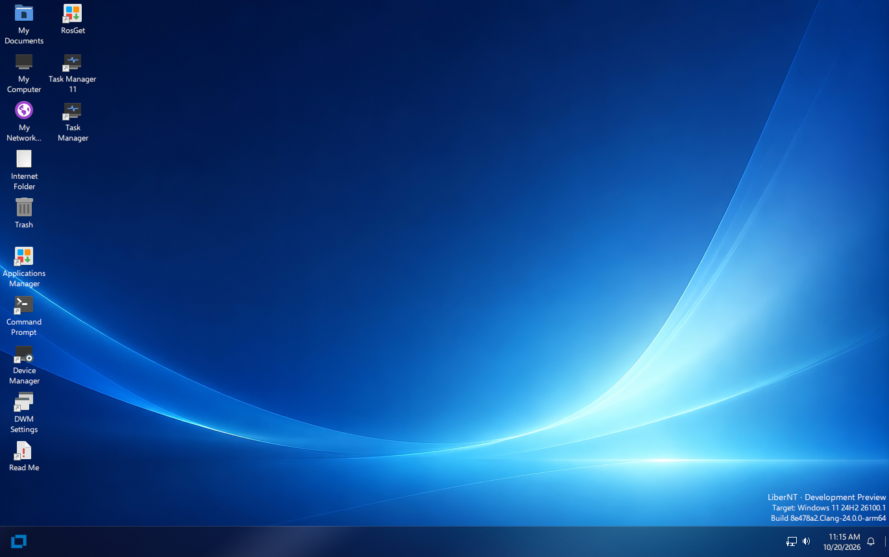

> [English](../../README.md) | [中文](../zh-CN/README.md) | **Français** | [Español](../es-ES/README.md) | [日本語](../ja-JP/README.md) | [العربية](../ar-MA/README.md) | [Українська](../uk-UA/README.md)

<p align="center">
  
</p>

> [!IMPORTANT]
> LiberNT est en plein développement. Les compilations de la page [Releases](https://github.com/LiberNT/LiberNT/releases) sont des préversions Debug destinées aux tests : lancez-les dans une machine virtuelle ou sur du matériel de rechange, pas sur un ordinateur dont vous dépendez.

<div align="center">

# [LiberNT](https://libernt.com)
### Un système d'exploitation NT libre

**Né de l'amour de l'architecture NT. Compatible Windows® 11, pour amd64, arm64 et riscv64.**

[](https://github.com/LiberNT/LiberNT/actions/workflows/build.yml)
[](#licence)
[](https://discord.gg/BpcKg7FZ2)
[](https://matrix.to/#/#libernt:matrix.org)


<br>

[](https://github.com/LiberNT/LiberNT/releases)

</div>

## Sponsors

<p align="center">
  <a href="https://github.com/sponsors/ahmedarif193">
    
  </a>
</p>

---

<p align="center">
  
</p>

<p align="center"><sub>Le bureau de LiberNT sur arm64, compilation nt10.0-043-2555 dans QEMU</sub></p>

---

LiberNT est un système d'exploitation NT libre. Le nom le dit : *liber* signifie **libre** en latin. Il vise la **compatibilité avec Windows® 11**, avec de la place pour des fonctions libres et expérimentales.

LiberNT apporte un travail approfondi sur les composants de l'espace noyau et les pilotes, tourné vers la stabilité et le matériel moderne, et se concentre sur les plateformes 64 bits : **amd64, arm64 et riscv64**.

Notre objectif est un système maintenable sur le long terme : **stable, fiable et efficace**, qui fonctionne aussi sur les appareils embarqués et qui puisse offrir toutes les fonctions qu'un système d'exploitation moderne doit avoir.

> [!NOTE]
> Vous découvrez NT ? **NT** est l'architecture qui se trouve derrière toutes les versions modernes de Windows : son noyau, son modèle de pilotes et ses services système. LiberNT est un système d'exploitation libre construit sur cette architecture, et Windows 11 est la référence à laquelle il se mesure.

---

## Table des matières

- [Ce que contient LiberNT](#ce-que-contient-libernt)
- [Plateformes prises en charge](#plateformes-prises-en-charge)
- [Prise en main](#prise-en-main)
  - [Étape 1 : télécharger une compilation](#étape-1-télécharger-une-compilation)
  - [Étape 2 : la démarrer](#étape-2-la-démarrer)
  - [Étape 3 : installer LiberNT](#étape-3-installer-libernt)
- [Compiler LiberNT vous-même](#compiler-libernt-vous-même)
- [Systèmes de compilation](#systèmes-de-compilation)
- [Structure du projet](#structure-du-projet)
- [Contribuer](#contribuer)
- [Utilisation de l'IA](#utilisation-de-lia)
- [Licence](#licence)
- [À propos](#à-propos)

---

## Ce que contient LiberNT

LiberNT apporte le matériel et les plateformes modernes à l'architecture NT.

| Fonction | Ce que cela signifie pour vous |
| --- | --- |
| **Le 64 bits d'abord** | Le noyau, la HAL et FreeLoader fonctionnent sur amd64, arm64 et riscv64. |
| **Démarrage UEFI** | Démarre sur un micrologiciel UEFI, avec un framebuffer GOP et un affichage précoce. Le disque préinstallé démarre en UEFI ou en BIOS. |
| **Bus et stockage modernes** | PCIe, PCI, Plug and Play, USB avec xHCI, SD/eMMC, ainsi que des pilotes de stockage et de bus. |
| **Prise en charge des cartes** | De vraies cartes, dont le Raspberry Pi et son contrôleur d'E/S RP1. |
| **Le modèle de pilotes de Windows 11** | Compatibilité Windows 11 (NT10) et travail sur le modèle de pilotes, vérifiés par rapport à Windows 11 lui-même. |
| **Graphismes et applications x86 sur Arm** | Le modèle de pilotes graphiques avec Mesa, et WoW64 avec FEX, sont des options de compilation que vous pouvez activer. |
| **Installation de LiberNT** | Affiche les disques comme le programme d'installation de Windows, crée, supprime, formate, réduit et étend les partitions, et installe LiberNT sur NTFS avec la partition système EFI dont il a besoin. |
| **Votre propre compilation** | `menuconfig` vous permet de choisir la cible, le compilateur et le type de compilation, et d'activer ou de désactiver des fonctions. |

> [!TIP]
> Chaque compilation de la page [Releases](https://github.com/LiberNT/LiberNT/releases) indique ce qui a changé depuis la précédente.

---

## Plateformes prises en charge

| Architecture | Images précompilées | Compilation depuis les sources | Remarques |
| --- | :---: | :---: | --- |
| **amd64** | ✓ | ✓ | Clang (par défaut) ou GCC |
| **arm64** | ✓ | ✓ | Avec la prise en charge du Raspberry Pi |
| **riscv64** | ✓ | ✓ | Une image distincte est compilée pour les cartes JH7110 |
| **i386** | | ✓ | x86 32 bits |

Les compilations publiées comprennent aussi des images PowerPC.

---

## Prise en main

### Étape 1 : télécharger une compilation

Chaque compilation de la page [Releases](https://github.com/LiberNT/LiberNT/releases) est fournie sous forme d'un fichier ZIP par image et par architecture :

| Fichier | Ce que c'est |
| --- | --- |
| `bootcd-iso-…-<arch>-…zip` | `bootcd.iso`, une image de CD qui lance LiberNT ou démarre l'installation de LiberNT |
| `LiberNT-img-…-<arch>-…zip` | `LiberNT.img`, un disque où LiberNT est déjà installé |
| `LiberNT-vhd-…-<arch>-…zip` | `LiberNT.vhd`, le même disque préinstallé pour les machines virtuelles utilisant VHD |
| `LiberNT-vhdx-…-<arch>-…zip` | `LiberNT.vhdx`, le même disque préinstallé pour Hyper-V génération 2 |

> [!NOTE]
> Ce sont des compilations Debug réalisées avec Clang par GitHub Actions à partir de la branche `main-nt10`.

### Étape 2 : la démarrer

Le moyen le plus rapide d'essayer LiberNT est le disque préinstallé :

1. Décompressez `LiberNT.img` (ou `LiberNT.vhd`)
2. Lancez-le dans une machine virtuelle comme **QEMU**, ou utilisez le VHD dans **VirtualBox** ou dans une machine virtuelle **Hyper-V** de génération 1. Hyper-V génération 2 n'accepte que `LiberNT.vhdx`, avec le démarrage sécurisé désactivé
3. Ou écrivez `LiberNT.img` sur une clé USB ou une carte SD et démarrez la machine dessus. Il démarre en UEFI ou en BIOS

> [!CAUTION]
> Écrire `LiberNT.img` sur une clé USB ou une carte SD efface tout son contenu. Vérifiez bien le périphérique cible avant.

### Étape 3 : installer LiberNT

Démarrez `bootcd.iso` dans une machine virtuelle ou sur un PC, et suivez les instructions de l'**installation de LiberNT**.

Le disque préinstallé contient aussi l'installation de LiberNT. Lancez `C:\<architecture>\libernt.exe`, par exemple `C:\arm64\libernt.exe`, pour installer LiberNT sur un autre disque depuis le système en cours d'exécution.

> [!CAUTION]
> L'installation peut supprimer et formater des partitions. Sauvegardez tout ce qui est important sur le disque cible avant d'installer.

Consultez [INSTALL.md](INSTALL.md) pour le guide d'installation complet.

---

## Compiler LiberNT vous-même

LiberNT se compile avec RosBE, une chaîne de compilation croisée. Les étapes ci-dessous fonctionnent sous Linux et macOS, et sous Windows via WSL2.

### 1. Installer la chaîne de compilation

Il vous faut Git, CMake, Ninja et un compilateur C/C++ pour votre propre machine. RosBE ajoute les compilateurs qui compilent LiberNT.

```sh
curl -fsSL https://raw.githubusercontent.com/LiberNT/libernt-build-toolchain/main/rosbe-unix-bootstrap.sh | sh
```

> [!TIP]
> Sous Windows, nous conseillons WSL2. Installez-le avec `wsl --install`, ouvrez le terminal Linux qu'il ajoute et suivez-y les étapes Linux. Gardez les sources dans le système de fichiers Linux plutôt que sous `/mnt/c`, où les compilations sont plus lentes.

### 2. Récupérer les sources

```sh
git clone https://github.com/LiberNT/LiberNT.git
cd LiberNT
```

> [!NOTE]
> La première configuration récupère aussi le sous-module et les sources externes dont la compilation a besoin.

### 3. Configurer

```sh
./configure.sh
```

Sans option, cela prépare une compilation AMD64 Debug avec Clang dans le dossier `output-Clang-amd64-debug`. Le nom du dossier suit toujours le modèle `output-<compilateur>-<architecture>-<debug|release>`.

| Option | Ce qu'elle fait |
| --- | --- |
| `-a`, `--arch <arch>` | Choisit l'architecture cible : `amd64` (par défaut), `i386`, `arm64` ou `riscv64`. |
| `--clang` | Compile avec le Clang/LLVM de RosBE. C'est le choix par défaut. |
| `--gcc` | Compile avec le GCC de RosBE au lieu de Clang. Le RosBE pour macOS ne contient pas GCC. |
| `-r`, `--release` | Produit une compilation Release optimisée. Sans cette option, vous obtenez une compilation Debug, plus facile à déboguer. |
| `menuconfig` | Ouvre d'abord un menu pour choisir les composants optionnels. Vos choix sont conservés dans le dossier de sortie. |
| `makefiles` | Utilise `make` au lieu de Ninja. |
| `--no-feeds-update` | Ne récupère pas les sources externes listées dans `feeds.conf`, par exemple hors ligne. |
| `-D<name>=<value>` | Transmet un réglage directement à CMake. |

Par exemple :

```sh
./configure.sh -a arm64              # compilation ARM64 Debug avec Clang
./configure.sh -a i386 --gcc         # compilation x86 32 bits avec GCC
./configure.sh -a amd64 --release    # compilation AMD64 optimisée
```

Pour une compilation plus personnalisée, ajoutez `menuconfig` :

```sh
./configure.sh menuconfig
```

Cela ouvre un menu, très proche de celui du noyau Linux, où vous choisissez la cible, le compilateur et le type de compilation, et activez ou désactivez des fonctions : génération et réglage du code, modèle de pilotes graphiques et Mesa, WoW64 et FEX, débogage du noyau, exécution des tests, et plus encore. Appuyez sur `?` sur n'importe quelle option pour l'aide, sur `S` pour enregistrer et sur `Q` pour quitter. Vos choix sont enregistrés dans le dossier de sortie et réutilisés à chaque nouvelle configuration.

### 4. Compiler

Placez-vous dans le dossier de sortie et lancez Ninja avec la cible voulue :

```sh
cd output-Clang-amd64-debug
ninja liberntimg
```

| Commande | Crée | Pour |
| --- | --- | --- |
| `ninja bootcd` | `bootcd.iso` | Installer LiberNT depuis une image de CD, dans une machine virtuelle ou sur un PC. |
| `ninja liberntimg` | `LiberNT.img` | Démarrer un disque où LiberNT est déjà installé. Lancez-le dans une machine virtuelle comme QEMU, ou écrivez-le sur une clé USB ou une carte SD. Il démarre en UEFI ou en BIOS. |
| `ninja liberntvhd` | `LiberNT.vhd`, `LiberNT.vhdx` | Utiliser le même disque préinstallé dans des machines virtuelles : le VHD dans VirtualBox et Hyper-V génération 1, le VHDX dans Hyper-V génération 2, qui n'accepte pas les disques VHD. |

Chaque cible compile d'abord tout ce dont elle a besoin, et les fichiers sont écrits dans le dossier de sortie.

---

## Systèmes de compilation

| Système | Compilateurs | Remarques |
| --- | --- | --- |
| **Linux** x86_64 / aarch64 | Clang et GCC | La chaîne RosBE complète |
| **macOS** Intel / Apple Silicon | Clang | RosBE n'a pas de version GCC pour macOS |
| **Windows** | Clang et GCC | Via WSL2, en suivant les étapes Linux |

Sur chaque système, installez Git, CMake, Ninja, Flex et Bison avec votre gestionnaire de paquets. RosBE ne fournit que les compilateurs croisés. Les chaînes de compilation précompilées se trouvent dans [LiberNT/libernt-build-toolchain](https://github.com/LiberNT/libernt-build-toolchain).

---

## Structure du projet

```text
LiberNT/
├── base/            # Applications, services, installation et shell
├── boot/            # FreeLoader, données et images de démarrage
├── bootloader/      # Gestionnaire de démarrage, chargeur Windows, prise en charge d'UEFI et d'Open Firmware
├── dll/             # DLL en mode utilisateur, dont ntdll et les bibliothèques Win32
├── drivers/         # Pilotes en mode noyau : bus, stockage, systèmes de fichiers, réseau, entrée, etc.
├── hal/             # Couches d'abstraction matérielle pour x86, Arm, Arm64, PowerPC et RISC-V
├── media/           # Polices, thèmes, fichiers INF, sons et identité visuelle
├── modules/         # Applications optionnelles, tests et fonds d'écran
├── ntos/            # Le noyau et l'exécutif NT
├── sdk/             # En-têtes, bibliothèques et outils de compilation
├── submodules/      # Recettes et correctifs des composants externes
├── subsystems/      # CSRSS et le sous-système Windows
│   └── win/win32k/  # win32k, USER, GDI et pilotes d'affichage
├── configure.sh     # Prépare une compilation sous Linux, macOS et WSL2
└── configure.cmd    # Prépare une compilation sous Windows
```

---

## Contribuer

Signalez les bogues et proposez des fonctions dans les [Issues](https://github.com/LiberNT/LiberNT/issues), et trouvez des guides et des notes dans le [Wiki](https://github.com/LiberNT/LiberNT/wiki).

Consultez [CONTRIBUTING.md](CONTRIBUTING.md) et [PULL_REQUEST_MANAGEMENT.md](PULL_REQUEST_MANAGEMENT.md). Si vous prévoyez une modification importante, posez d'abord la question dans les [Issues](https://github.com/LiberNT/LiberNT/issues) ou sur [Discord](https://discord.gg/BpcKg7FZ2).

> [!WARNING]
> **Avis juridique :** si vous avez vu du code source propriétaire de Microsoft Windows (notamment, sans s'y limiter, le code source divulgué de Windows NT 3.5, NT 4 et 2000, et le Windows Research Kernel), votre contribution ne sera pas acceptée en raison d'une possible violation du droit d'auteur.

---

## Utilisation de l'IA

Soyons clairs : l'IA fait partie de la façon dont LiberNT est construit. Elle nous aide à relire et à écrire du code, et tout ce qu'elle écrit est ensuite relu par une personne. Avant que quoi que ce soit n'arrive dans la branche principale, une personne exécute et valide les tests de bout en bout. Ce projet nous tient trop à cœur pour laisser passer une régression.

Elle nous aide aussi à lire la documentation, à extraire des définitions et à corriger des bogues. Pour un bogue donné, elle compare ce que dit la documentation officielle de Microsoft Learn avec ce que fait réellement notre fonction, afin que nous voyions exactement où notre comportement diffère.

Comme tout autre outil, l'IA est là pour nous aider à atteindre nos objectifs. Elle suit les mêmes règles que celles que nous nous imposons, décrites dans [AGENTS.md](../../AGENTS.md) :

- Nous construisons à partir des en-têtes du Windows SDK et du WDK, des symboles publics de Windows 11, de la documentation Microsoft et d'exécutions en boîte noire sous Windows 11.
- Nous travaillons en salle blanche : nous ne retranscrivons jamais de code Windows désassemblé ou décompilé, et nous ne copions jamais de code GPL de Linux.
- Un correctif n'en est un qu'une fois que nous l'avons vu fonctionner lors d'un vrai démarrage ou d'une exécution de tests. Une fois les tests réussis, une future CI veillera à ce qu'ils le restent et préservera nos progrès.
- Nous comparons nos résultats de tests, vérification par vérification, avec les mêmes tests exécutés sous Windows 11.

> [!TIP]
> Si vous utilisez l'IA dans vos propres contributions, vous êtes aussi le bienvenu. Dites-nous simplement dans la pull request pour quelles parties elle vous a aidé et comment vous les avez testées. Cette honnêteté est tout ce que nous demandons.

---

## Licence

LiberNT est distribué sous la [GNU GPL 3.0](../../COPYING). Le code hérité d'autres projets conserve la licence indiquée dans l'en-tête de ses fichiers, le plus souvent la GPL 2.0 ou ultérieure. Les textes de la GPL 2.0, de la LGPL 2.1 et de la licence BSD auxquels ces fichiers font référence se trouvent dans [COPYING2](../../COPYING2), [COPYING.LIB](../../COPYING.LIB) et [COPYING.ARM](../../COPYING.ARM).

Les modifications apportées dans LiberNT sont sous Copyright © 2026 les contributeurs de LiberNT. Le code hérité et tiers conserve les mentions de copyright de ses auteurs. Consultez [CREDITS.md](../../CREDITS.md).

LiberNT est un projet indépendant. Il n'est ni affilié à Microsoft, ni approuvé, ni parrainé par Microsoft. Windows® est une marque déposée de Microsoft Corporation.

---

## À propos

LiberNT est développé par les **contributeurs de LiberNT** ; il a été lancé par [Ahmed Arif](https://github.com/ahmedarif193) et est maintenu par [Ahmed Arif](https://github.com/ahmedarif193), [Ostap Brehin](https://github.com/osbre) et [Vivyy](https://github.com/enginelesscc).

- [Visiter l'organisation LiberNT](https://github.com/LiberNT)
- [Site web](https://libernt.com)
- [Télécharger la dernière compilation](https://github.com/LiberNT/LiberNT/releases)
- [Wiki](https://github.com/LiberNT/LiberNT/wiki)
- Discutez sur [Discord](https://discord.gg/BpcKg7FZ2) ou sur [Matrix](https://matrix.to/#/#libernt:matrix.org)
