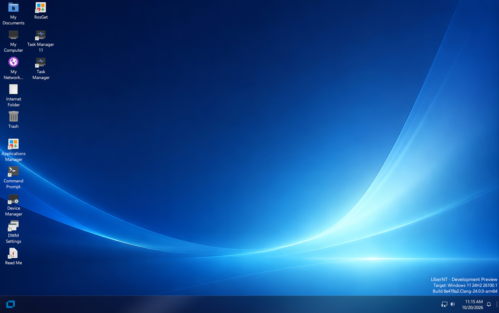

> [English](../../README.md) | [中文](../zh-CN/README.md) | [Français](../fr-FR/README.md) | [Español](../es-ES/README.md) | **日本語** | [العربية](../ar-MA/README.md) | [Українська](../uk-UA/README.md)

<p align="center">
  
</p>

> [!IMPORTANT]
> LiberNT は活発に開発中です。[Releases](https://github.com/LiberNT/LiberNT/releases) ページのビルドはテスト用の Debug プレリリースです。仮想マシンや予備のハードウェアで実行し、普段使いのコンピューターでは実行しないでください。

<div align="center">

# [LiberNT](https://libernt.com)
### 自由な NT オペレーティングシステム

**NT アーキテクチャへの愛から生まれました。Windows® 11 互換、amd64・arm64・riscv64 対応。**

[](https://github.com/LiberNT/LiberNT/actions/workflows/build.yml)
[](#ライセンス)
[](https://discord.gg/BpcKg7FZ2)
[](https://matrix.to/#/#libernt:matrix.org)


<br>

[](https://github.com/LiberNT/LiberNT/releases)

</div>

## スポンサー

<p align="center">
  <a href="https://github.com/sponsors/ahmedarif193">
    
  </a>
</p>

---

<p align="center">
  
</p>

<p align="center"><sub>arm64 上の LiberNT デスクトップ。QEMU で実行したビルド nt10.0-043-2555</sub></p>

---

LiberNT は自由な NT オペレーティングシステムです。名前がそれを表しています。*liber* はラテン語で**自由**を意味します。**Windows® 11 との互換性**を目標とし、自由で実験的な機能の余地も残しています。

LiberNT はカーネル空間のコンポーネントとドライバーに大規模な改良を加えており、安定性と最新のハードウェアを重視し、64 ビットプラットフォーム（**amd64・arm64・riscv64**）に注力しています。

私たちの目標は、長期にわたって保守できるシステムです。**安定していて、信頼でき、効率的**で、組み込み機器でも動作し、最新のオペレーティングシステムが備えるべきあらゆる機能をサポートできるシステムを目指しています。

> [!NOTE]
> NT は初めてですか？ **NT** は、最新のすべての Windows を支えるアーキテクチャです。カーネル、ドライバーモデル、システムサービスがこれにあたります。LiberNT はこのアーキテクチャの上に築かれた自由なオペレーティングシステムで、Windows 11 を比較の基準としています。

---

## 目次

- [LiberNT に含まれるもの](#libernt-に含まれるもの)
- [対応プラットフォーム](#対応プラットフォーム)
- [はじめに](#はじめに)
  - [ステップ 1: ビルドをダウンロードする](#ステップ-1-ビルドをダウンロードする)
  - [ステップ 2: 起動する](#ステップ-2-起動する)
  - [ステップ 3: LiberNT をインストールする](#ステップ-3-libernt-をインストールする)
- [LiberNT を自分でビルドする](#libernt-を自分でビルドする)
- [ビルドホスト](#ビルドホスト)
- [プロジェクトの構成](#プロジェクトの構成)
- [貢献する](#貢献する)
- [AI の利用](#ai-の利用)
- [ライセンス](#ライセンス)
- [このプロジェクトについて](#このプロジェクトについて)

---

## LiberNT に含まれるもの

LiberNT は最新のハードウェアとプラットフォームを NT アーキテクチャにもたらします。

| 機能 | あなたにとっての意味 |
| --- | --- |
| **64 ビット優先** | カーネル、HAL、FreeLoader が amd64、arm64、riscv64 で動作します。 |
| **UEFI ブート** | UEFI ファームウェアで起動し、GOP フレームバッファーと早期の画面表示に対応します。プリインストール済みディスクは UEFI と BIOS のどちらでも起動します。 |
| **最新のバスとストレージ** | PCIe、PCI、プラグアンドプレイ、xHCI による USB、SD/eMMC、そしてストレージとバスのドライバー。 |
| **ボードのサポート** | Raspberry Pi とその RP1 I/O コントローラーを含む実機ボード。 |
| **Windows 11 のドライバーモデル** | Windows 11 (NT10) との互換性とドライバーモデルの取り組みを、Windows 11 そのものと照らし合わせて確認しています。 |
| **Arm でのグラフィックスと x86 アプリ** | Mesa を使ったグラフィックスドライバーモデルと、FEX を使った WoW64 は、有効にできるビルドオプションです。 |
| **LiberNT セットアップ** | Windows セットアップと同じようにドライブを一覧表示し、パーティションの作成、削除、フォーマット、縮小、拡張を行い、必要な EFI システムパーティションとともに LiberNT を NTFS にインストールします。 |
| **自分だけのビルド** | `menuconfig` で、ターゲット、コンパイラー、ビルドの種類を選び、機能のオン・オフを切り替えられます。 |

> [!TIP]
> [Releases](https://github.com/LiberNT/LiberNT/releases) ページの各ビルドには、前回からの変更点が記載されています。

---

## 対応プラットフォーム

| アーキテクチャ | ビルド済みイメージ | ソースからのビルド | 備考 |
| --- | :---: | :---: | --- |
| **amd64** | ✓ | ✓ | Clang（既定）または GCC |
| **arm64** | ✓ | ✓ | Raspberry Pi のサポートを含む |
| **riscv64** | ✓ | ✓ | JH7110 ボード用に別のイメージをビルド |
| **i386** | | ✓ | 32 ビット x86 |

リリースビルドには PowerPC イメージも含まれます。

---

## はじめに

### ステップ 1: ビルドをダウンロードする

[Releases](https://github.com/LiberNT/LiberNT/releases) ページの各ビルドは、イメージとアーキテクチャごとに 1 つの ZIP ファイルで提供されます。

| ファイル | 内容 |
| --- | --- |
| `bootcd-iso-…-<arch>-…zip` | `bootcd.iso`。LiberNT を実行するか、LiberNT セットアップを起動する CD イメージ |
| `LiberNT-img-…-<arch>-…zip` | `LiberNT.img`。LiberNT がインストール済みのディスク |
| `LiberNT-vhd-…-<arch>-…zip` | `LiberNT.vhd`。VHD ベースの仮想マシン向けの、同じプリインストール済みディスク |
| `LiberNT-vhdx-…-<arch>-…zip` | `LiberNT.vhdx`。Hyper-V 第 2 世代向けの、同じプリインストール済みディスク |

> [!NOTE]
> これらは、GitHub Actions が `main-nt10` ブランチから作成した Clang の Debug ビルドです。

### ステップ 2: 起動する

LiberNT を最も手早く試せるのは、プリインストール済みディスクです。

1. `LiberNT.img`（または `LiberNT.vhd`）を展開します
2. **QEMU** などの仮想マシンで起動するか、VHD を **VirtualBox** または **Hyper-V** 第 1 世代の仮想マシンで使います。Hyper-V 第 2 世代は `LiberNT.vhdx` しか受け付けず、セキュアブートを無効にする必要があります
3. または、`LiberNT.img` を USB ドライブや SD カードに書き込み、そこからマシンを起動します。UEFI と BIOS のどちらでも起動します

> [!CAUTION]
> `LiberNT.img` を USB ドライブや SD カードに書き込むと、その中身はすべて消去されます。書き込み先のデバイスを必ず確認してください。

### ステップ 3: LiberNT をインストールする

仮想マシンまたは PC で `bootcd.iso` を起動し、**LiberNT セットアップ**の指示に従います。

プリインストール済みディスクにも LiberNT セットアップが入っています。実行中のシステムから別のディスクに LiberNT をインストールするには、`C:\<アーキテクチャ>\libernt.exe`（たとえば `C:\arm64\libernt.exe`）を実行します。

> [!CAUTION]
> セットアップはパーティションを削除・フォーマットできます。インストールの前に、インストール先ディスクの大切なデータをバックアップしてください。

インストール手順の詳細は [INSTALL.md](INSTALL.md) を参照してください。

---

## LiberNT を自分でビルドする

LiberNT は、クロスビルド用ツールチェーンの RosBE でビルドします。以下の手順は Linux と macOS、そして WSL2 経由の Windows で使えます。

### 1. ツールチェーンをインストールする

自分のマシン用の Git、CMake、Ninja、C/C++ コンパイラーが必要です。RosBE は LiberNT をビルドするコンパイラーを追加します。

```sh
curl -fsSL https://raw.githubusercontent.com/LiberNT/libernt-build-toolchain/main/rosbe-unix-bootstrap.sh | sh
```

> [!TIP]
> Windows では WSL2 をおすすめします。`wsl --install` でインストールし、追加された Linux ターミナルを開いて、そこで Linux の手順に従ってください。ソースは `/mnt/c` の下ではなく Linux のファイルシステム内に置いてください。`/mnt/c` ではビルドが遅くなります。

### 2. ソースを取得する

```sh
git clone https://github.com/LiberNT/LiberNT.git
cd LiberNT
```

> [!NOTE]
> 最初の構成時に、ビルドに必要なサブモジュールと外部ソースも取得されます。

### 3. 構成する

```sh
./configure.sh
```

オプションを付けない場合、`output-Clang-amd64-debug` フォルダーに Clang による AMD64 Debug ビルドが構成されます。フォルダー名は常に `output-<コンパイラー>-<アーキテクチャ>-<debug|release>` というパターンになります。

| オプション | 動作 |
| --- | --- |
| `-a`, `--arch <arch>` | ターゲットのアーキテクチャを選びます。`amd64`（既定）、`i386`、`arm64`、`riscv64` のいずれかです。 |
| `--clang` | RosBE の Clang/LLVM でビルドします。これが既定です。 |
| `--gcc` | Clang の代わりに RosBE の GCC でビルドします。macOS 版の RosBE には GCC が含まれません。 |
| `-r`, `--release` | 最適化された Release ビルドを作成します。指定しない場合は、デバッグしやすい Debug ビルドになります。 |
| `menuconfig` | 先にメニューを開き、オプションのコンポーネントを選びます。選択内容は出力フォルダーに保存されます。 |
| `makefiles` | Ninja の代わりに `make` を使います。 |
| `--no-feeds-update` | `feeds.conf` に記載された外部ソースの取得を省略します。オフライン時などに使います。 |
| `-D<name>=<value>` | 設定を CMake にそのまま渡します。 |

例:

```sh
./configure.sh -a arm64              # Clang による ARM64 Debug ビルド
./configure.sh -a i386 --gcc         # GCC による 32 ビット x86 ビルド
./configure.sh -a amd64 --release    # 最適化された AMD64 ビルド
```

より自分好みのビルドにするには、`menuconfig` を追加します。

```sh
./configure.sh menuconfig
```

Linux カーネルのものによく似たメニューが開き、ターゲット、コンパイラー、ビルドの種類を選んだり、機能のオン・オフを切り替えたりできます。コード生成とチューニング、グラフィックスドライバーモデルと Mesa、WoW64 と FEX、カーネルデバッグ、テスト実行などです。各オプションで `?` を押すとヘルプ、`S` で保存、`Q` で終了します。選択内容は出力フォルダーに保存され、再構成するたびに使われます。

### 4. ビルドする

出力フォルダーに移動し、目的のターゲットを指定して Ninja を実行します。

```sh
cd output-Clang-amd64-debug
ninja liberntimg
```

| コマンド | 作成されるもの | 用途 |
| --- | --- | --- |
| `ninja bootcd` | `bootcd.iso` | 仮想マシンまたは PC で、CD イメージから LiberNT をインストールする。 |
| `ninja liberntimg` | `LiberNT.img` | LiberNT がインストール済みのディスクを起動する。QEMU などの仮想マシンで起動するか、USB ドライブや SD カードに書き込みます。UEFI と BIOS のどちらでも起動します。 |
| `ninja liberntvhd` | `LiberNT.vhd`、`LiberNT.vhdx` | 同じプリインストール済みディスクを仮想マシンで使う。VHD は VirtualBox と Hyper-V 第 1 世代で、VHDX は VHD ディスクを受け付けない Hyper-V 第 2 世代で使います。 |

各ターゲットは必要なものをすべて先にビルドし、ファイルは出力フォルダーに書き出されます。

---

## ビルドホスト

| ホスト | コンパイラー | 備考 |
| --- | --- | --- |
| **Linux** x86_64 / aarch64 | Clang と GCC | RosBE ツールチェーン一式 |
| **macOS** Intel / Apple Silicon | Clang | RosBE には macOS 用の GCC ビルドがありません |
| **Windows** | Clang と GCC | WSL2 経由で、Linux の手順に従います |

どのホストでも、Git、CMake、Ninja、Flex、Bison をパッケージマネージャーでインストールしてください。RosBE が提供するのはクロスコンパイラーだけです。ビルド済みのツールチェーンは [LiberNT/libernt-build-toolchain](https://github.com/LiberNT/libernt-build-toolchain) にあります。

---

## プロジェクトの構成

```text
LiberNT/
├── base/            # アプリケーション、サービス、セットアップ、シェル
├── boot/            # FreeLoader、ブートデータ、ブートイメージ
├── bootloader/      # ブートマネージャー、Windows ローダー、UEFI と Open Firmware のサポート
├── dll/             # ntdll と Win32 ライブラリを含むユーザーモード DLL
├── drivers/         # カーネルモードドライバー: バス、ストレージ、ファイルシステム、ネットワーク、入力など
├── hal/             # x86、Arm、Arm64、PowerPC、RISC-V 用のハードウェア抽象化レイヤー
├── media/           # フォント、テーマ、INF ファイル、サウンド、ブランド素材
├── modules/         # オプションのアプリケーション、テスト、壁紙
├── ntoskrnl/        # NT カーネルとエグゼクティブ
├── sdk/             # ヘッダー、ライブラリ、ビルドツール
├── submodules/      # 外部コンポーネントのレシピとパッチ
├── subsystems/      # CSRSS と Windows サブシステム
├── win32ss/         # win32k、USER、GDI、ディスプレイドライバー
├── configure.sh     # Linux、macOS、WSL2 でビルドを構成する
└── configure.cmd    # Windows でビルドを構成する
```

---

## 貢献する

バグの報告や機能の提案は [Issues](https://github.com/LiberNT/LiberNT/issues) で、ガイドやメモは [Wiki](https://github.com/LiberNT/LiberNT/wiki) で見つけられます。

[CONTRIBUTING.md](CONTRIBUTING.md) と [PULL_REQUEST_MANAGEMENT.md](PULL_REQUEST_MANAGEMENT.md) を参照してください。大きな変更を計画している場合は、先に [Issues](https://github.com/LiberNT/LiberNT/issues) または [Discord](https://discord.gg/BpcKg7FZ2) で相談してください。

> [!WARNING]
> **法的注意事項:** Microsoft Windows のプロプライエタリなソースコード（流出した Windows NT 3.5、NT 4、2000 のソースコードや Windows Research Kernel を含みますが、これらに限りません）を見たことがある場合、著作権侵害のおそれがあるため、あなたの貢献は受け付けられません。

---

## AI の利用

はっきりさせておきます。AI は LiberNT の開発方法の一部です。コードのレビューや作成を手伝い、AI が書いたものはすべて人間がレビューします。メインブランチに何かが入る前に、人間がエンドツーエンドのテストを実行して検証します。私たちはこのプロジェクトを大切に思っているので、リグレッションを見逃すことはしません。

AI は、ドキュメントを読む、定義を抽出する、バグを修正するといった作業も手伝います。個々のバグについて、Microsoft Learn の公式ドキュメントの記述と私たちの関数の実際の動作を比較し、動作がどこで食い違っているかを正確に把握できるようにします。

ほかのツールと同じように、AI は私たちが目標を達成するための助けです。AI も、私たちが自らに課している [AGENTS.md](../../AGENTS.md) のルールに従います。

- Windows SDK と WDK のヘッダー、Windows 11 の公開シンボル、Microsoft のドキュメント、Windows 11 上でのブラックボックス実行をもとに開発します。
- クリーンルームを守ります。逆アセンブルや逆コンパイルした Windows のコードを書き写すことは決してなく、Linux の GPL コードをコピーすることもありません。
- 修正は、実際の起動やテスト実行で動作を確認して初めて修正といえます。テストが通るようになったら、将来の CI がそれを維持し、全体の進捗を守ります。
- テスト結果は、Windows 11 で実行した同じテストと 1 項目ずつ比較します。

> [!TIP]
> 自分の貢献に AI を使っている方も歓迎します。どの部分で AI の助けを借り、どのようにテストしたかをプルリクエストで伝えてください。お願いしたいのは、その誠実さだけです。

---

## ライセンス

LiberNT は [GNU GPL 3.0](../../COPYING) でライセンスされています。ほかのプロジェクトから引き継いだコードは、ファイルのヘッダーに記載されたライセンスを維持しており、その多くは GPL 2.0 以降です。これらのファイルが参照する GPL 2.0、LGPL 2.1、BSD のライセンス文は [COPYING2](../../COPYING2)、[COPYING.LIB](../../COPYING.LIB)、[COPYING.ARM](../../COPYING.ARM) にあります。

LiberNT で加えられた変更の著作権は Copyright © 2026 LiberNT コントリビューターに帰属します。引き継いだコードやサードパーティのコードは、作者の著作権表示を維持します。[CREDITS.md](../../CREDITS.md) を参照してください。

LiberNT は独立したプロジェクトです。Microsoft との提携はなく、Microsoft による承認や後援も受けていません。Windows® は Microsoft Corporation の登録商標です。

---

## このプロジェクトについて

LiberNT は **LiberNT コントリビューター**によって開発されており、[Ahmed Arif](https://github.com/ahmedarif193) が立ち上げ、[Ahmed Arif](https://github.com/ahmedarif193)、[Ostap Brehin](https://github.com/osbre)、[Vivyy](https://github.com/enginelesscc) がメンテナンスしています。

- [LiberNT オーガニゼーションを見る](https://github.com/LiberNT)
- [ウェブサイト](https://libernt.com)
- [最新のビルドをダウンロード](https://github.com/LiberNT/LiberNT/releases)
- [Wiki](https://github.com/LiberNT/LiberNT/wiki)
- [Discord](https://discord.gg/BpcKg7FZ2) または [Matrix](https://matrix.to/#/#libernt:matrix.org) でチャット
